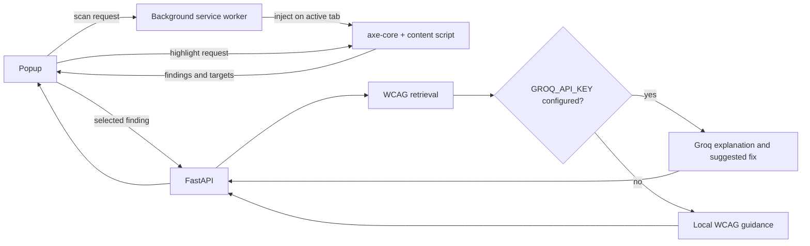

# A11yLens

**A11yLens** is a Chrome extension that finds common accessibility issues on the page you choose to scan, points to the affected elements, and explains a selected issue using WCAG guidance. The optional Python backend can use Groq to produce a plain-language explanation and a suggested HTML correction.

The name uses **a11y**, a common numeronym for accessibility, and **lens** for inspecting a page.

## What works in this first milestone

- Manifest V3 extension with a popup that scans the active tab on demand.
- axe-core is packaged locally and checks WCAG 2.0, 2.1, and 2.2 A/AA rules.
- Violations and items needing manual review are shown separately.
- Affected elements can be highlighted on the page.
- Scan results can be exported as a JSON report. The export omits page HTML, URL query parameters, and URL fragments.
- A FastAPI endpoint retrieves relevant WCAG criteria and returns local guidance. If a Groq key is configured, it also returns an AI explanation and suggested HTML.
- The Groq key stays in the backend `.env` file. The extension sends only the selected finding's short HTML snippet when you request **Get WCAG guidance**.

Automated accessibility scanners cannot judge every requirement. An axe result is a useful audit, not proof that a page conforms to WCAG.

## How the pieces fit



For a beginner-friendly walkthrough of the files and request flow, see [the architecture guide](docs/ARCHITECTURE.md).
See [the roadmap](docs/ROADMAP.md) for milestones and [the project log](docs/PROJECT_LOG.md) for current decisions and handoff notes.

## Project layout

```text
extension/                 Chrome extension source
  icons/                   Extension toolbar and store icons
  scripts/copy-axe.js      Copies the installed axe-core bundle into the extension
  scripts/build-icons.ps1  Regenerates PNG icons on Windows
  background.js            Injects scanner files only after a user starts a scan
  content.js               Runs axe and highlights selected targets
  popup.html / popup.css   Accessible popup UI
  popup.js                 Popup behavior and backend requests
backend/
  data/wcag.json            WCAG 2.2 A/AA summary corpus with W3C source links
  main.py                   FastAPI routes and optional Groq call
  rag.py                    Rule mapping, FAISS embeddings, and TF-IDF fallback
  requirements-rag.txt      Optional local embedding and FAISS dependencies
  scripts/build_wcag_corpus.py  Refreshes the W3C WCAG 2.2 A/AA summaries
  .env.example              Backend configuration template
```

## Run locally

### 1. Prepare the extension bundle

From the project root, run:

```powershell
Set-Location extension
npm install
npm run build
```

The build step copies `axe.min.js` and its license notices into `extension/vendor/`. The generated scanner is ignored by Git and must exist before loading the extension.

### 2. Start the backend

From the project root, create and activate a virtual environment, then install the backend packages:

```powershell
py -m venv backend/.venv
backend/.venv/Scripts/python.exe -m pip install -r backend/requirements.txt
Copy-Item backend/.env.example backend/.env
```

Edit `backend/.env` and set `GROQ_API_KEY` if you want AI-generated explanations. The default model is `openai/gpt-oss-20b`; set `GROQ_MODEL` to another model available to your Groq account if needed. With no key, the API still returns local WCAG guidance.

### Optional: enable semantic WCAG retrieval

The backend works without model packages by using rule mappings and a local TF-IDF fallback. To enable the roadmap's local embedding + FAISS path, install its optional dependencies:

```powershell
backend/.venv/Scripts/python.exe -m pip install -r backend/requirements-rag.txt
```

The default model is `sentence-transformers/all-MiniLM-L6-v2`. Sentence Transformers downloads it to the local model cache the first time an explanation is requested. Embeddings are generated locally; page HTML is not sent to an embedding service. If the packages or model are unavailable, A11yLens falls back to TF-IDF retrieval.

Refresh the checked-in W3C 2.2 A/AA summary corpus with:

```powershell
backend/.venv/Scripts/python.exe backend/scripts/build_wcag_corpus.py
```

The corpus uses short summaries from W3C WAI's Understanding documents. W3C describes those documents as informative, so use the linked success criterion and professional review for conformance decisions.

Start the API from the project root:

```powershell
backend/.venv/Scripts/python.exe -m uvicorn main:app --app-dir backend --reload --host 127.0.0.1 --port 8000
```

The API is local-only by default. Its health page is `http://127.0.0.1:8000/health` and interactive API docs are at `http://127.0.0.1:8000/docs`.

### 3. Load the extension in Chrome

1. Open `chrome://extensions` and enable **Developer mode**.
2. Choose **Load unpacked** and select this project's `extension/` folder.
3. Open a normal website, click the A11yLens icon, then click **Scan this page**.
4. Use an **Inspect element** button to highlight a target. Use **Get WCAG guidance** on a finding to ask the local API for an explanation. Scanning works locally if the API is offline.

The extension cannot scan Chrome internal pages, the Chrome Web Store, or some protected browser pages. Reload a page after reloading the extension if Chrome reports that the content script is unavailable.

## Data and privacy

Scanning runs in the page after you invoke it. It does not send a whole page to the backend. When you choose **Get WCAG guidance**, the extension sends the selected axe rule, description, impact, target selector, and a short HTML snippet to the local backend. If `GROQ_API_KEY` is configured, that selected finding is then sent from the backend to Groq. Do not send a finding from a page containing information you do not want to share with the configured provider.

The extension uses `activeTab` and `scripting` for on-demand page access, `storage` for temporary scan results, and a localhost host permission for the local API. It does not need a Groq key or access to every page at install time.

## Build roadmap

The supplied six-week roadmap is tracked in [docs/ROADMAP.md](docs/ROADMAP.md). Milestones 1–4 are implemented in this repository; milestone 5 is in progress. A JSON report export and maintenance docs are now part of that milestone. Evaluation data and outcome measurements remain to be built.

The retrieval pipeline is rule-aware and supports a local FAISS index. Its corpus contains short W3C Understanding summaries for WCAG 2.2 A/AA criteria, not the complete normative standard. The GitHub source repository is public, but the FastAPI backend still runs locally and has not been deployed as a hosted service. Chrome Web Store publication is future work.

## License notes

The A11yLens source does not have a license file yet. axe-core is a separate dependency with its own license and notices; retain those notices when distributing the extension.

## Maintaining this repository

- Follow [CONTRIBUTING.md](CONTRIBUTING.md) for the local build and change workflow.
- Review [CHANGELOG.md](CHANGELOG.md) when preparing a release.
- Keep the data-flow draft in [docs/PRIVACY.md](docs/PRIVACY.md) aligned with code and review it before publication.
- Use the GitHub issue templates for bug reports and feature ideas.
- Keep `backend/.env` and other secrets out of commits. The project does not have a chosen source license yet; decide that before inviting reuse or publishing a release.
