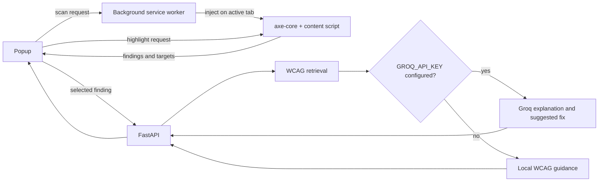

# A11yLens

**A11yLens** is a Chrome extension and mobile-first web auditor for finding common accessibility issues on a page, understanding who they affect, and reviewing practical fixes. Its Python backend uses local WCAG retrieval and can use Groq for structured plain-language explanations.

The name uses **a11y**, a common numeronym for accessibility, and **lens** for inspecting a page.

## What works in this first milestone

- Manifest V3 extension with a popup that scans the active tab on demand.
- axe-core is packaged locally and checks WCAG 2.0, 2.1, and 2.2 A/AA rules.
- Violations and items needing manual review are shown separately. Manual-review cards use a neutral "Possible issue" label and offer guidance clearly marked as review help. Summary counts distinguish rules from affected violation elements.
- Affected elements can be highlighted on the page.
- Scan results can be exported as a JSON report. The export omits page HTML, URL query parameters, and URL fragments.
- A FastAPI endpoint retrieves relevant WCAG criteria and returns local guidance. If a Groq key is configured, it also returns an AI explanation and suggested HTML.
- The Groq key stays in the backend `.env` file. The extension sends only the selected finding's short HTML snippet when you request **Get WCAG guidance**.

Automated accessibility scanners cannot judge every requirement. An axe result is a useful audit, not proof that a page conforms to WCAG.

## How the pieces fit



For a beginner-friendly walkthrough of the files and request flow, see [the architecture guide](docs/ARCHITECTURE.md).
See [the roadmap](docs/ROADMAP.md) for milestones and [the project log](docs/PROJECT_LOG.md) for current decisions and handoff notes.
For the latest status and a Claude-ready handoff, see the [10 November project report](docs/A11YLENS_HANDOFF_2026-11-10.md) and its [complete bundled PDF](output/pdf/A11yLens_Full_Project_Handoff_2026-11-10.pdf). The [earlier technical snapshot](docs/A11YLENS_PROJECT_PROGRESS_REPORT.md) and its [PDF copy](output/pdf/A11yLens_Project_Progress_Report.pdf) remain available as historical detail.

## Project layout

```text
extension/                 Chrome extension source
  icons/                   Extension toolbar and store icons
  scripts/copy-axe.js      Copies the installed axe-core bundle into the extension
  scripts/build-icons.ps1  Regenerates PNG icons on Windows
  background.js            Injects scanner files only after a user starts a scan
  page-policy.js           Allows web pages and rejects browser or store pages
  guidance-errors.js       Shows WCAG API failures next to the affected finding
  content.js               Runs axe and highlights selected targets
  popup.html / popup.css   Accessible popup UI
  popup.js                 Popup behavior and backend requests
  tests/                   Focused tests for popup status, API errors, and page policy
backend/
  data/wcag.json            WCAG 2.2 A/AA summary corpus with W3C source links
  main.py                   FastAPI routes and optional Groq call
  rag.py                    Rule mapping, FAISS embeddings, and TF-IDF fallback
  scanner.py                Playwright Chromium scan with axe-core and request limits
  scan_logic.py             Public URL validation and A11yLens score formula
  report_store.py           MongoDB storage for report share links
  tests/                    URL, score, scan endpoint, and storage tests
  requirements-rag.txt      Optional local embedding and FAISS dependencies
  scripts/build_wcag_corpus.py  Refreshes the W3C WCAG 2.2 A/AA summaries
  .env.example              Backend configuration template
web/
  server.js                 Node server using runtime API_BASE_URL
  index.html / styles.css   Mobile-first, keyboard-accessible report interface
  app.js                    Scan, report, score, share, and copy-fix behavior
  package.json              Node start script for Embarko deployment
```

## Run locally

### 1. Prepare the extension bundle

From the project root, run:

```powershell
Set-Location extension
npm install
npm run build
```

The build step copies `axe.min.js` and its license notices into `extension/vendor/`. The generated scanner is ignored by Git and must exist before loading the extension.

### 2. Start the backend

From the project root, create and activate a virtual environment, then install the backend packages:

```powershell
py -m venv backend/.venv
backend/.venv/Scripts/python.exe -m pip install -r backend/requirements.txt
Copy-Item backend/.env.example backend/.env
backend/.venv/Scripts/python.exe -m playwright install chromium
```

Edit `backend/.env` and set `GROQ_API_KEY` if you want AI-generated explanations. The default model is `openai/gpt-oss-20b`; set `GROQ_MODEL` to another model available to your Groq account if needed. With no key, the API still returns local WCAG guidance.

### Optional: enable semantic WCAG retrieval

The backend works without model packages by using rule mappings and a local TF-IDF fallback. To enable the roadmap's local embedding + FAISS path, install its optional dependencies:

```powershell
backend/.venv/Scripts/python.exe -m pip install -r backend/requirements-rag.txt
```

The default model is `sentence-transformers/all-MiniLM-L6-v2`. Sentence Transformers downloads it to the local model cache the first time an explanation is requested. Embeddings are generated locally; page HTML is not sent to an embedding service. If the packages or model are unavailable, A11yLens falls back to TF-IDF retrieval.

Refresh the checked-in W3C 2.2 A/AA summary corpus with:

```powershell
backend/.venv/Scripts/python.exe backend/scripts/build_wcag_corpus.py
```

The corpus uses short summaries from W3C WAI's Understanding documents. W3C describes those documents as informative, so use the linked success criterion and professional review for conformance decisions.

Start the API from the project root:

```powershell
backend/.venv/Scripts/python.exe -m uvicorn main:app --app-dir backend --reload --host 127.0.0.1 --port 8000
```

The API is local-only by default. Its health page is `http://127.0.0.1:8000/health` and interactive API docs are at `http://127.0.0.1:8000/docs`.

For a safe local-only setup, optional Groq configuration, and API error troubleshooting, see [the backend setup guide](docs/LOCAL_BACKEND_SETUP.md). Groq mode has not yet been exercised in this project.

### 3. Load the extension in Chrome

1. Open `chrome://extensions` and enable **Developer mode**.
2. Choose **Load unpacked** and select this project's `extension/` folder.
3. Open a normal website, click the A11yLens icon, then click **Scan this page**.
4. Use **Axe rule help** to read about a rule, or **Inspect element** to highlight a target. Use **Get WCAG guidance** on a violation or manual-review finding. Start `start-api.cmd` first and keep its console open; local WCAG guidance works without a Groq key. Manual-review guidance is for considering a possible issue, not treating it as a confirmed failure. Scanning works locally if the API is offline.

The extension cannot scan Chrome internal pages, the Chrome Web Store, or some protected browser pages. Reload a page after reloading the extension if Chrome reports that the content script is unavailable.

## A11yLens Web

The web app accepts one public HTTP/HTTPS URL and scans it with headless Chromium, Playwright, and the same local axe-core version used by the extension. The API checks URL DNS results and redirects, limits browser time and downloaded resources, and applies a per-client rate limit. Groq explanations use the existing WCAG retrieval and fall back to local guidance when Groq is unavailable. Reports are saved in MongoDB and served through share links when `MONGODB_URI` is configured.

The **A11yLens score** is a project estimate, not an official WCAG rating. For each axe rule, subtract its impact weight multiplied by up to five affected elements: critical 12, serious 8, moderate 4, minor 1. The final score is `max(0, 100 - total penalties)`. Unknown impact uses the minor weight. Impact counts use axe-core's affected-element totals; the same element can count under multiple rules.

The app itself is mobile-first and keyboard accessible. Its scan findings and AI snippets are displayed as text. Public share links can be opened by anyone who has the link; saved report URLs omit query strings and fragments. When MongoDB storage is enabled, full reports (including sampled HTML and explanations) persist until the database operator deletes them; the current app has no automatic expiry or delete route. Review [the privacy disclosure](docs/PRIVACY.md) before enabling report storage for a public deployment.

For a one-click local start on Windows, double-click `start-local.cmd`; it opens the API and web server in separate windows and then opens the web app at `http://localhost:4173/` in Brave when installed in its default location. Keep both server windows open. The API root at `http://127.0.0.1:8000/` reports the web app address, and its health check is at `/health`. You can also start the API and web server separately using the commands in [the deployment guide](docs/A11YLENS_WEB_DEPLOYMENT.md#local-development).

For local setup, MongoDB Atlas configuration, CORS settings, and the Embarko frontend/API hosting split, see [the A11yLens Web deployment guide](docs/A11YLENS_WEB_DEPLOYMENT.md). Deployment steps are available for [Azure for Students](ops/azure-student/README.md) if eligible, with an [Oracle Always Free VM fallback](ops/oracle-vm/README.md). Run the focused backend tests from the project root with:

```powershell
backend/.venv/Scripts/python.exe -m unittest discover -s backend/tests -v
```

## Data and privacy

Scanning runs in the page after you invoke it. It does not send a whole page to the backend. When you choose **Get WCAG guidance**, the extension sends the selected axe rule, description, impact, target selector, and a short HTML snippet to the local backend. If `GROQ_API_KEY` is configured, that selected finding is then sent from the backend to Groq. Do not send a finding from a page containing information you do not want to share with the configured provider.

The extension uses `activeTab` and `scripting` for on-demand page access, `storage` for temporary scan results, and a localhost host permission for the local API. It does not need a Groq key or access to every page at install time.

## Where the project stands

The Chrome extension and the first A11yLens Web implementation are in the project. On 16 November 2026, the local API completed a real Playwright scan of W3C using the installed Brave browser. That single scan verifies the browser launch and report path; it is not an accuracy evaluation or a WCAG conformance result. The 360 px and 390 px web layouts have no horizontal overflow and returned zero automated axe WCAG A/AA violations after a header-label fix. A short keyboard pass confirmed visible focus; manual screen-reader review remains pending. MongoDB and Groq are not configured, so reports are not saved and AI explanations are off. The API and frontend are local and have not been deployed. Remaining work includes connecting MongoDB, deploying the API to a container-capable host and the frontend to Embarko, and completing manual browser accessibility review. One automated axe run of the two local evaluation fixtures is recorded; extension popup end-to-end scans, repair comparisons, and human review remain pending. See [the evaluation instructions](evaluation/README.md), [the recorded fixture run](evaluation/RUN_2026-11-27.md), and [the Web deployment guide](docs/A11YLENS_WEB_DEPLOYMENT.md).

The WCAG reference set uses short summaries from W3C pages, not the full standard. The web tests mock browser scans and MongoDB; they do not measure real-page accuracy or confirm a live deployment. Groq mode, MongoDB persistence, and public deployment still need live checks. The source code is public on GitHub; the API is not hosted and the extension is not published in the Chrome Web Store.

## License

I haven't chosen a license for A11yLens yet. The axe-core license and notices are kept under `extension/vendor`.

## Keeping the project organized

- [CONTRIBUTING.md](CONTRIBUTING.md) has the build steps.
- [CHANGELOG.md](CHANGELOG.md) records changes, and [docs/PROJECT_LOG.md](docs/PROJECT_LOG.md) keeps the current decisions and next steps.
- I keep the data-flow notes in [docs/PRIVACY.md](docs/PRIVACY.md) so I can update them if the code changes.
- Never commit `backend/.env` or API keys.
