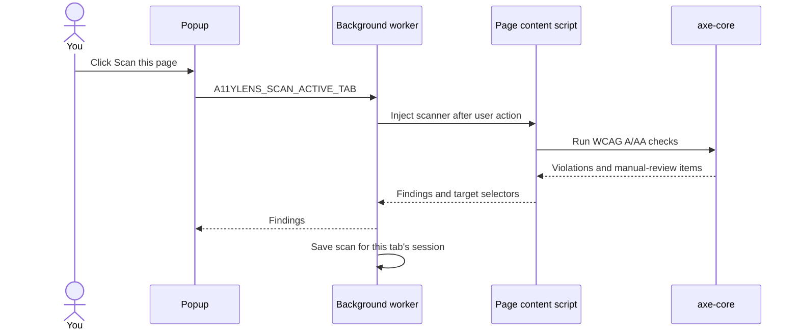

# A11yLens architecture guide

This guide explains the first milestone in the same order the app runs. The project is split into two parts: a Chrome extension that scans the page, and a Python API that explains one selected finding.

## 1. When you click “Scan this page”

1. `popup.js` sends the message `A11YLENS_SCAN_ACTIVE_TAB` to the extension.
2. `background.js` finds the active tab. It injects the locally packaged axe-core file and `content.js` into that tab only after you start the scan.
3. `content.js` asks axe-core to check the page against WCAG A/AA tags. It returns rule findings, a few affected HTML snippets, and selectors for locating the elements.
4. `background.js` returns the results to the popup and saves them in session storage. That lets the popup restore the results if it closes while you inspect the page.
5. `popup.js` creates the result cards using DOM text nodes. Finding text is not inserted as HTML, so page content cannot become executable popup markup.



## 2. What the key extension files do

- `extension/manifest.json` tells Chrome this is a Manifest V3 extension. `activeTab` and `scripting` allow a user-started scan of the active page. `storage` lets the popup recover a scan for the current browser session. The host permission is limited to the local API.
- `extension/background.js` coordinates the scan and rejects browser pages that cannot be inspected.
- `extension/content.js` runs axe-core and provides `A11YLENS_HIGHLIGHT` and `A11YLENS_CLEAR_HIGHLIGHT` messages. It temporarily changes the selected element's outline, then can restore the original inline styles.
- `extension/popup.html` supplies the page structure and accessible status regions.
- `extension/popup.css` controls the popup's layout, focus ring, severity colors, and compact result cards.
- `extension/popup.js` talks to the worker and API, creates cards, and displays backend text safely with `textContent`.
- `extension/scripts/copy-axe.js` copies the installed axe-core browser file and its license notices into `extension/vendor/`. `extension/vendor/axe.min.js` is generated, not hand-edited.

## 3. A finding's data shape

The extension keeps a finding small enough to display and send for explanation:

```json
{
  "id": "image-alt",
  "impact": "critical",
  "description": "Images must have alternative text",
  "nodes": [
    {
      "target": ["img.hero"],
      "html": "",
      "failureSummary": "..."
    }
  ]
}
```

The exact values come from axe-core and vary by page. The extension shows up to 25 affected elements per rule and sends only the first affected element when you request an explanation.

## 4. How “Inspect element” works

axe-core includes a target selector for each element. The popup sends that target back to `content.js`. The content script locates it, stores its existing inline outline styles, applies a visible outline, and scrolls the element into view. The clear button restores the previous inline values.

Some nested frame or shadow-DOM targets may not be directly locatable by this starter inspector. The finding remains visible even when the element cannot be highlighted.

## 5. How the explanation request works

When you press **Get WCAG guidance**, `popup.js` sends a `POST /explain` request to `http://127.0.0.1:8000`. The JSON body contains the axe rule ID, description, impact, selector, one short HTML snippet, and axe-core's failure summary for that element. The API rejects unknown fields and limits each string's length. Page scanning itself does not require the backend.

The request flow is:

1. `backend/main.py` validates the input with Pydantic.
2. `backend/rag.py` checks a hand-reviewed axe-rule-to-WCAG mapping, then ranks the WCAG 2.2 A/AA summary corpus with local FAISS embeddings when its optional packages are installed. Without them, it uses TF-IDF lexical retrieval.
3. With no `GROQ_API_KEY`, the API returns local guidance that clearly says it is not an AI-generated code fix.
4. With a key, the API sends the selected snippet and retrieved criteria from the backend to Groq. The prompt identifies page HTML as untrusted data, asks the model not to invent criteria, and requests JSON output.
5. The API checks that returned criterion IDs came from the retrieved set, then sends the explanation to the popup.

The browser extension contains no secret. The key belongs in `backend/.env`, which Git ignores.

## 6. What “RAG” means here

RAG stands for retrieval-augmented generation. A system first retrieves reference material relevant to a question, then gives that material to a language model as context. A11yLens first uses a curated axe-rule mapping, then ranks the WCAG 2.2 A/AA corpus. Install `backend/requirements-rag.txt` to use sentence-transformer embeddings with a FAISS cosine-similarity index. The index is built in memory on the first explanation request and reused for the API process. Without those optional packages, the backend falls back to local TF-IDF matching.

The corpus stores concise summaries from W3C WAI's Understanding documents and links each record to its source. W3C marks those documents as informative; they help explain a criterion but are not its complete normative text. Retrieved criteria are references for review, not a conformance verdict.

## 7. Beginner-friendly learning order

1. Read `manifest.json` and identify the extension's entry points and permissions.
2. Trace `A11YLENS_SCAN_ACTIVE_TAB` from the button in `popup.js` to `background.js`.
3. Read `runScan()` in `content.js` and compare its fields with the `finding` object above.
4. Follow an **Inspect element** button through `popup.js` to `highlight()` in `content.js`.
5. Follow **Get WCAG guidance** from `popup.js` to the Pydantic model and `/explain` route in `backend/main.py`.
6. Read `RULE_TO_CRITERIA` and `retrieve_criteria()` in `backend/rag.py`, then compare the FAISS path with its TF-IDF fallback.

## 8. Exporting a scan report

After a scan, choose **Export JSON** in the results heading. `popup.js` builds a versioned report with the scan time, page title and cleaned page URL, summary counts, and one row per axe finding. The export removes URL credentials, query parameters, and fragments. It does not include page HTML snippets, failure summaries, or selectors. The file is created locally in the browser; it is not uploaded to the API.

The report format starts with `format: "a11ylens-report-v1"` so future versions can evolve while consumers can identify the schema. See [the project log](PROJECT_LOG.md) for current capabilities and [the roadmap](ROADMAP.md) for planned work.

## Current limits

- The local corpus covers WCAG 2.2 A/AA criteria. Axe mappings cover common rules; other rules rely on semantic or TF-IDF ranking and may need manual review.
- Semantic retrieval requires `backend/requirements-rag.txt` and downloads its model on first use. Without that optional setup, TF-IDF retrieval works offline.
- The AI suggestion is generated for one affected HTML snippet; it cannot infer all page context and should be reviewed.
- Automated axe results do not cover every accessibility requirement, and incomplete results require human review.
- The backend is configured for local development. Public deployment needs authentication or quota controls, a stricter CORS policy, monitored limits, and a privacy review.
- The project has not yet been evaluated against a repair corpus, deployed, or submitted to the Chrome Web Store.
